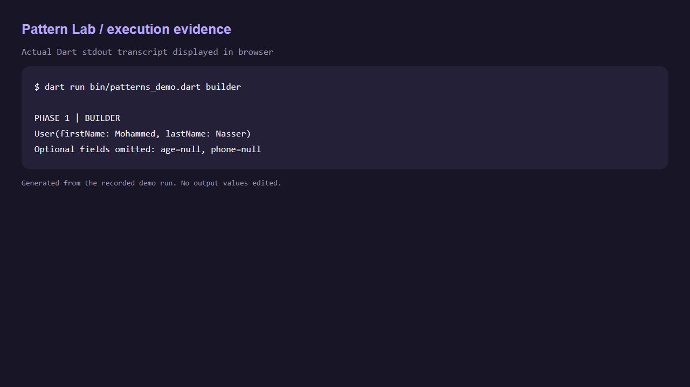
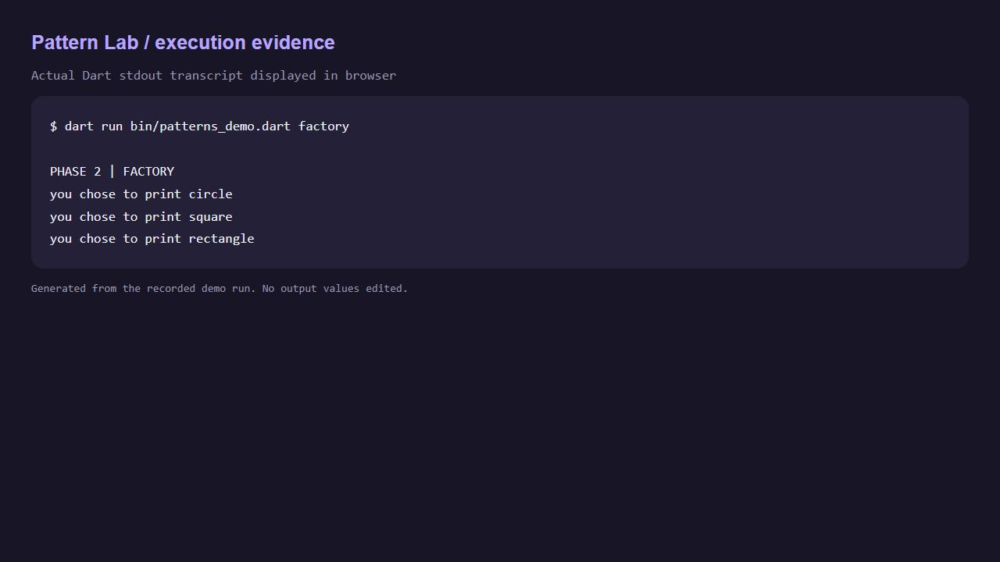
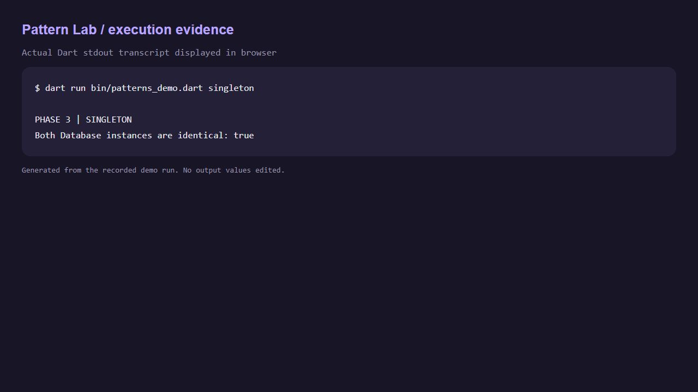
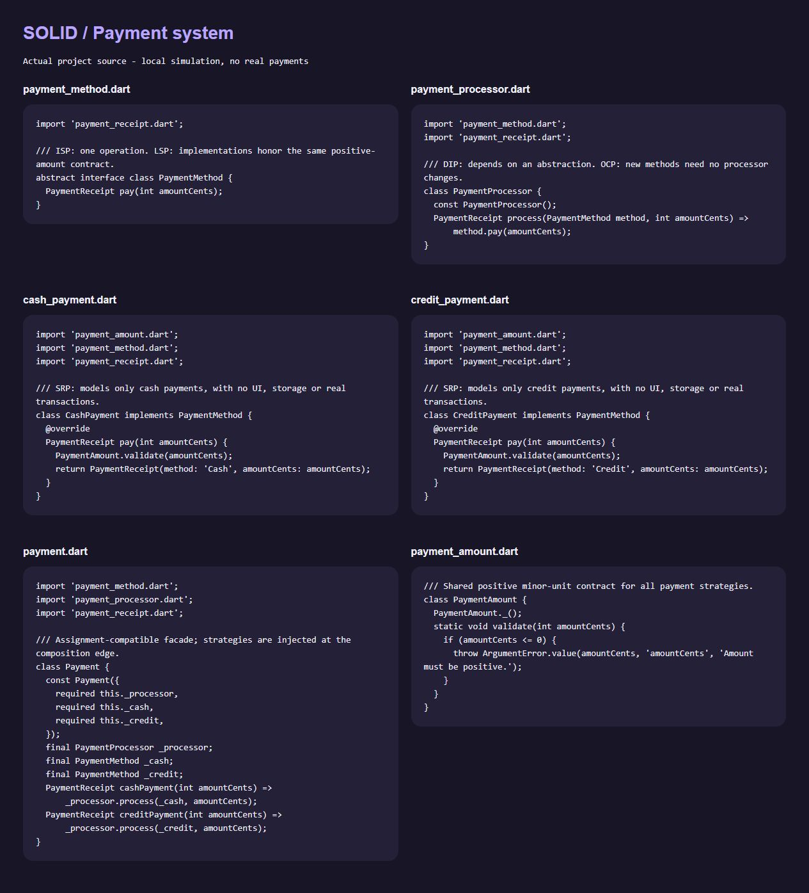

# Flutter Design Patterns & Clean Architecture — Mini Project

Five independent exercises plus a runnable Flutter learning-list app. Each class, widget and screen has a separate Dart file. No Firebase, API keys, payments gateway or account setup is required.

## Run

```bash
flutter pub get
flutter run -d chrome
dart run bin/patterns_demo.dart
```

Individual console examples: append `builder`, `factory`, `singleton` or `payment` to the demo command.

## Requirement map

| Phase | Implementation | Verification |
|---|---|---|
| Builder | `lib/patterns/builder/`: immutable User, chainable UserBuilder, UserClient | Both names required; age and phone optional; negative age rejected |
| Factory | `lib/patterns/factory/`: abstract Shape, three concrete shapes, switch-based ShapeFactory, ShapeClient | Three reveal messages; invalid types rejected |
| Singleton | `lib/patterns/singleton/`: private constructor, private static instance, createDatabase, DatabaseClient | Two calls return identical objects |
| SOLID | `lib/payments/`: Payment facade, PaymentMethod, strategies, PaymentProcessor, PaymentReceipt | Both required methods; invalid amounts rejected; additional test strategy |
| Clean Architecture | Data → domain repository interface → GetItems → ItemsCubit → BlocBuilder UI | Async fetching, loading, errors, retry, empty state and responsive list |

## SOLID decisions

- **Single Responsibility:** each payment strategy models one payment method; receipts store results; the processor orchestrates.
- **Open/Closed:** inject any new PaymentMethod without changing the processor. A test-only VoucherPayment proves extension.
- **Liskov Substitution:** cash, credit and voucher accept the same positive integer amount and return a PaymentReceipt; invalid amounts throw ArgumentError consistently.
- **Interface Segregation:** PaymentMethod exposes only pay; cash has no credit-specific methods to implement.
- **Dependency Inversion:** Payment and PaymentProcessor depend on abstractions. Concrete strategies are wired in the client.

Amounts are integer minor units to avoid floating-point arithmetic in the model. This is a simulation; no real money moves.

## Clean Architecture and DI

```text
lib/
  patterns/       Builder, Factory and Singleton exercises
  payments/       SOLID payment simulation
  data/           JSON model, local async source, repository implementation
  domain/         Entity, repository abstraction, GetItems use case
  presentation/   ItemsCubit, state, list screen, item widget
  injection.dart  GetIt registrations
  app.dart        Root widget and theme
  main.dart       Composition entry point
bin/patterns_demo.dart
test/            Pattern, payment, Cubit and UI tests
```

Domain has no Flutter or GetIt dependencies. Presentation receives GetItems via the injected Cubit. GetIt registers the source, repository and use case as lazy singletons and the Cubit as a factory; BlocProvider disposes its own Cubit. The source intentionally fetches deterministic local data asynchronously, which satisfies the fetching exercise without external credentials.

## Quality checks

```bash
dart format .
flutter analyze
flutter test
flutter build web
```

## Evidence

Console transcripts and screenshots are under `docs/`. Screenshots should be read alongside the exact command/output transcript; they are not mockups. GitHub publication status is tracked separately from local implementation.

## Verification results

- Dart analyzer: no issues found.
- Automated tests: 13 passed.
- Flutter release web build: succeeded.
- Browser verification: fetched list displayed after asynchronous loading.

## Screenshots

The first three images capture a browser display of the unedited stdout recorded from an actual Dart demo run, rather than the native terminal window. The full transcript is in [console-output.txt](docs/console-output.txt). Payment code is captured from the actual source; the app image is captured from the running Flutter web build.










## GitHub publication

Public repository: [MohammedNasser0/flutter-design-patterns-mini-project](https://github.com/MohammedNasser0/flutter-design-patterns-mini-project). This standalone project does not replace ConnectMe.

To reproduce the evidence viewer after building web, run `node tool/preview_server.cjs` and open the printed local URL.
