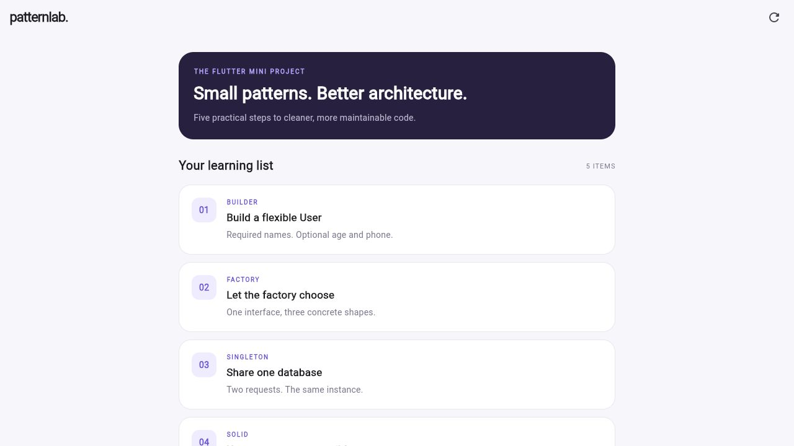

# Flutter Design Patterns Mini Project

A small Flutter project to practice design patterns, SOLID principles and Clean Architecture.

## What is included

- Builder: create a User with required first and last names. Age and phone are optional.
- Factory: create Circle, Square and Rectangle objects using ShapeFactory.
- Singleton: check that two Database calls return the same instance.
- SOLID: a simple cash and credit payment example. It does not make real payments.
- Clean Architecture: display a list of learning items using Cubit and GetIt.

## Project folders

The app code is split into data, domain and presentation. The pattern examples are in lib/patterns, and the payment example is in lib/payments.

## Run the app

```bash
flutter pub get
flutter run -d chrome
```

The app loads its list from local data, so it does not need Firebase or an API key.

To run the console examples:

```bash
dart run bin/patterns_demo.dart
```

## Testing

```bash
flutter analyze
flutter test
```

There are 13 tests covering the patterns, payments, Cubit and UI.

## Screenshots

Screenshots are in [docs/screenshots](docs/screenshots). The console images show the actual output displayed in a browser. The original output is saved in [console-output.txt](docs/console-output.txt).


